# URUC

An Android companion for Unfolded Circle remotes: start and stop activities from your phone, control the running one with a pad, a touchpad or the remote's own button pages, see what is playing (with the app's logo or the album art), open cameras full screen, set lights (brightness, color, white) and thermostats (target, mode) from a tap on their row, browse every entity and integration on the remote, and check the remote's battery, charger, power mode and connection. It talks to your remote directly on your home network through its official Core API: no account, no cloud relay, no tracking.

This repository holds signed release builds only.

<p>
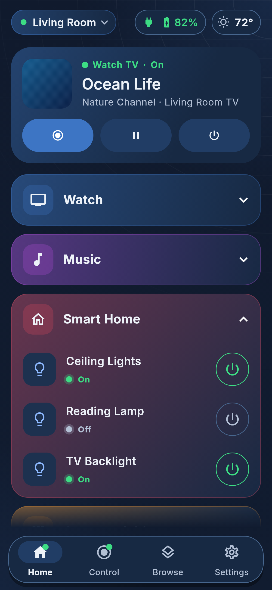
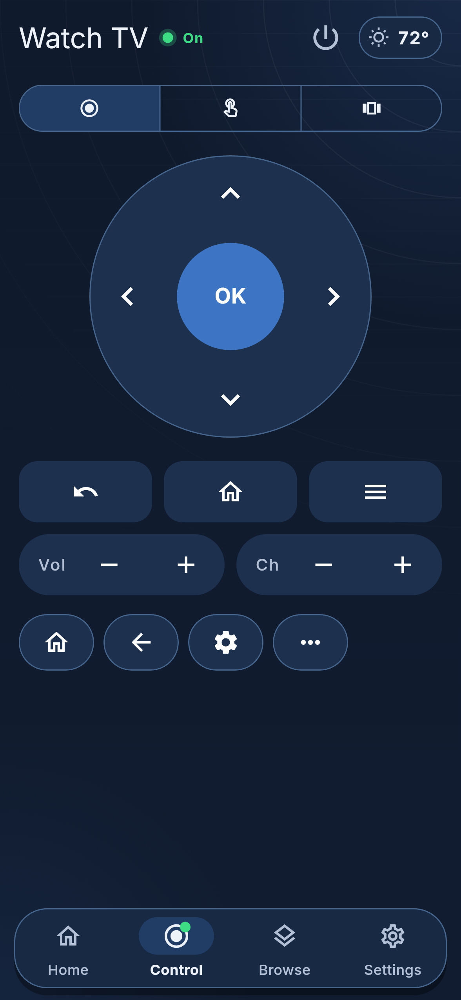
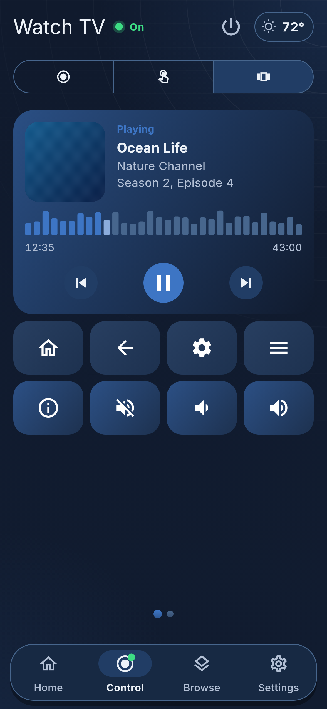
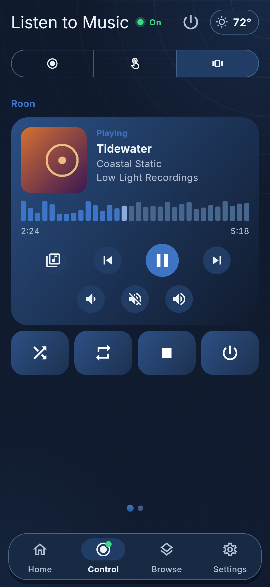
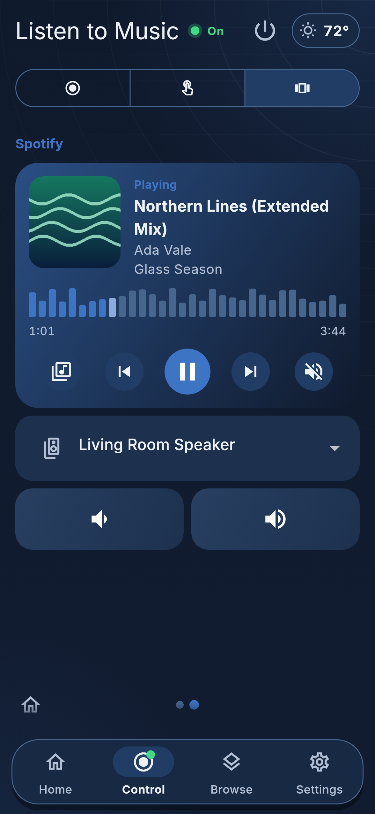
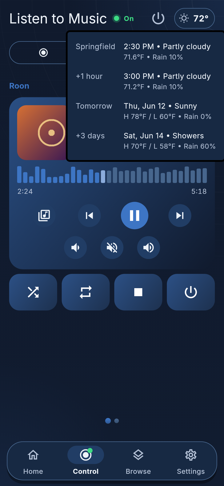
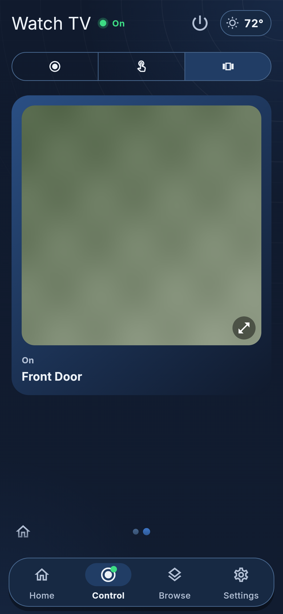
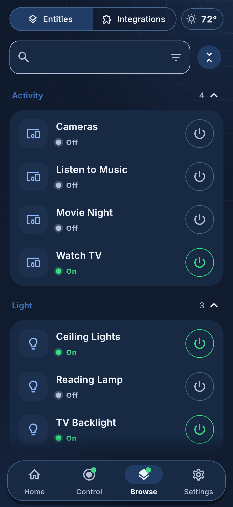
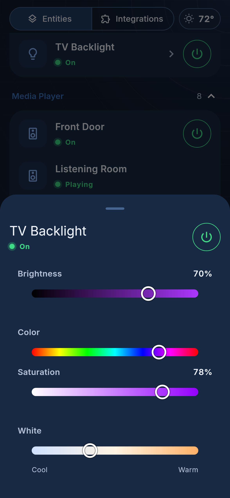
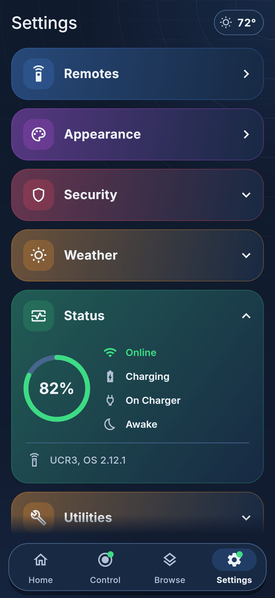
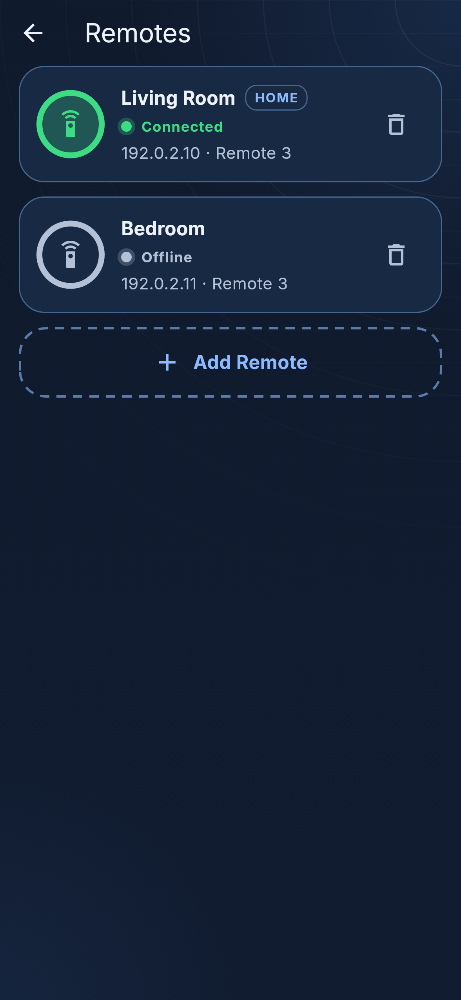
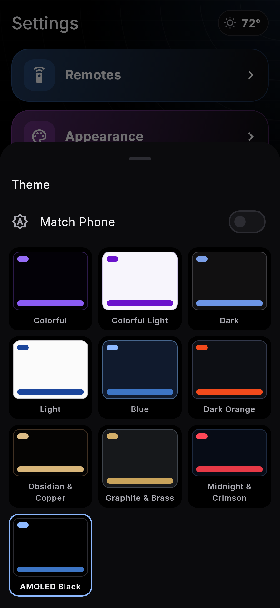
</p>

Screenshots show a demo remote.

## Install

1. On your Android phone, open the latest release: **https://github.com/guyp2k/uruc-releases/releases/latest** and download `uruc-<version>.apk`.
2. Open the file. Android asks you to allow installs from your browser or file manager the first time. Allow it, then install.
3. Open URUC, tap **Add Remote** and pick your remote from the list (or enter its address). Enter the remote's Web Configurator PIN, from the remote's settings.

Requirements: Android 7.0 or newer; an Unfolded Circle Remote 3 on the same network as the phone. URUC has been used with Remote 3s only.

## Check the download (optional)

Every release is signed with the same key. Its certificate's SHA-256 fingerprint is:

```
49:0D:CC:E6:4C:60:74:79:82:87:5D:B0:1C:6E:0D:19:B8:07:46:48:64:84:E6:08:A1:FE:C5:54:83:79:81:21
```

With the Android SDK: `apksigner verify --print-certs uruc-<version>.apk`. The `SHA-256 digest` line must match. Each release also lists the APK's SHA-256 checksum.

## Privacy

- URUC connects to the remotes you add, on your own network, and to the hosts that album and app art points to. It has no account, cloud relay, analytics, crash reporting or ads.
- When you pair a remote, URUC creates an API key on it named after this install of URUC. The key and the remote's address are kept in Android's encrypted storage on your phone and sent only to that remote. Removing a remote in URUC also revokes its key on the remote when it can reach it.
- Album art, app logos and camera pictures come from wherever the remote's integrations point. Those hosts see your phone's IP address and which pictures it asks for.
- **Share Log** (Settings, About) hands a text file of URUC's recent log to the app you pick in Android's share sheet; nothing is sent until you pick one. The log holds URUC's own short messages and the kind of any error, with remote ids, never keys, PINs or error text.
- With App Lock on, URUC asks for its PIN (or your fingerprint or face) when it opens and after it has been away, and hides its screen from the recent-apps view.

## Good to know

- **Home:** the running activity sits on top with what it is playing, and Control, Play or Pause and Off. Below are the remote's own Home pages as coloured sections; open one to start an activity or switch a light. Sections you open stay open next time.
- **Reorder:** long press a card's header on Home or in Settings and drag it. The order is kept on this phone only and the remote is not changed; a page added on the remote later goes to the end. Reset to Remote Order (Home) or Reset Order (Settings) puts it back.
- **Control:** Pad, Touchpad and Pages. Pages shows the activity's pages from the remote, swiped left and right, with the same icons and buttons. With nothing running, Control lists your activities to start, with search, a filter by Home group and expand or collapse.
- **Players:** a player on an activity page, such as Roon or Spotify, shows its picture, whether it is playing, the title on up to two lines (long press for all of it), the artist and album, and a row of level bars that light up to the place in the track, with the time played and the length. Previous, play or pause, next and the library share one row, and the card leaves out any volume or mute button the page already has for that player. The bars' heights are a pattern of their own for each track, not the sound.
- **Weather:** pick a temperature sensor from a weather integration on your remote in Settings, Weather, and tick the forecast rows you want. A pill with the temperature then sits at the top of every tab; tap it for the forecast, worded as the remote words it.
- **Modes:** an activity whose pages show only cameras opens straight on its pages. Long press an activity's name, or its Pad, Touchpad and Pages switch, to choose which modes it shows.
- **Pages loop:** swipe back from an activity's first page to reach its last.
- **Cameras:** a camera on an activity page fills the player card. Tap it to open it full screen; it follows the live picture and you can pinch to zoom.
- **Browse:** every entity on the remote by type, and every integration with its state, each with one search and filter field.
- **Status:** Settings, Status shows the remote's battery as a ring, its connection, charge, charger and power mode, and its model and OS.
- **Themes:** ten themes including AMOLED Black (a pure black page). Match Phone follows the phone's light or dark mode with one light and one dark pick.
- **Errors:** when the remote refuses a request, URUC shows the reason the remote gives. A remote that is slow to answer says so, and a press that timed out may still have worked.
- **App names on Android TV:** the Android TV integration reports the running app by its package name, so URUC shows the player's name with the app's logo instead.

## Support

URUC is a personal project, shared as-is. There is no support, and issues are not tracked. It shows whatever your remote reports, so most setups should just work; if yours does not, it may not be a fit.
